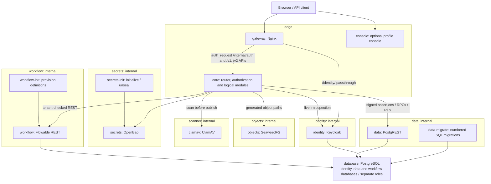

<!-- SPDX-FileCopyrightText: 2026 Junctura Contributors -->
<!-- SPDX-License-Identifier: Apache-2.0 -->

# Architecture

Junctura Core is a domain-neutral, headless platform exposing reusable infrastructure through authenticated APIs.
Use [CORE_API.md](CORE_API.md) for API contracts and [CAPABILITIES.md](CAPABILITIES.md) for optional capability reuse.
See [SECURITY.md](SECURITY.md) for authorization boundaries and [OPERATIONS.md](OPERATIONS.md) to operate and recover the stack.
Start a local stack with [GETTING_STARTED.md](GETTING_STARTED.md).
The three-tier model, repository map, call rules and storage consequences are in [TIER_MODEL.md](TIER_MODEL.md).

## Layer 1 — Headless PaaS

Required Core capabilities: Identity/SSO; API Gateway; structured data; unstructured/object data; workflow engine. All must be reusable independently of a single demo application's business rules.

Layer 1 is domain-neutral: Core code, the Console and Core examples carry no business vocabulary, workflow, unit, collection or field of any sector. Applications supply that knowledge as data at run time (BPMN definitions with `junctura:owner`/`junctura:group` metadata, collection names, capability manifests), so an upper layer can change its business without a Core change. `npm run check:neutral` enforces this in CI.

Two kinds of approval are kept apart:

| Approval | Examples | Layer |
| --- | --- | --- |
| Platform access | Register an application, publish a capability, share or revoke access, review break-glass access | Layer 1 (identity, security and zero-trust duties) |
| Business decision | Approve a request, verify a document, complete a workflow step | Layer 2 shared administrative processes and Layer 3 sector business rules; Core only provides the execution and authorization mechanisms |

The Junctura Console is the operator interface of Layer 1, comparable to Supabase Studio or the Directus Data Studio. It views platform state and decides platform access only; it never starts, completes, cancels or approves business work. Core runs fully without it (Compose profile `console`).

## Layer 2 — Shared digital workspace

At least one user-facing GUI application must exercise Core APIs in a real end-to-end scenario. Technical vendor administration consoles do not substitute for this application.

Layer 2 is [junctura-workspace](https://github.com/vku2-open-source-2026/junctura-workspace), the domain-neutral shared workspace with an end-user GUI: records, tasks, bulletins, directory and the H–P–D–I progression (digital work, process and records standardisation, data-driven operation, AI). It uses Layer 1 through `@junctura/server-client`, publishes APIs for Layer 3 applications and reads the industry pack installed for the deployment. The shared UI kit is `@junctura/ui`; the sample pack is Education. `junctura-workspace` is under construction; its records, tasks, bulletins and directory APIs for Layer 3 are target design. The Layer 2 demo level is reached when at least one H–P–D–I application uses the Core in an end-to-end flow; demo levels 2 and 3 are planned.

## Layer 3 — Sector packs and business applications

Layer 3 carries sector rules. Sector packs and applications live in separate repositories.

Applications own their business rules, data and screens. They use Layer 2 APIs, call Layer 1 within the limits in [TIER_MODEL.md](TIER_MODEL.md), and exchange with other Layer 3 applications only through one-time Layer 1 capability tickets under capability contracts, consent and audit. Removing Layer 3 leaves Layers 1 and 2 running. Applications are migrating their data to Layer 1. When complete, Layer 2 and Layer 3 applications must store business state through the Core API; removing an application container then keeps its data, and the Console can see the structure of the migrated data.

## Runtime topology

[compose.yaml](../compose.yaml) runs one Node.js Core process with private provider services and initialization jobs:

Subgraphs group providers; services can join several networks. Exact membership:

| Network | Services |
| --- | --- |
| `edge` | `core`, `gateway`, optional `console` |
| `identity` | `database`, `identity`, `core`, `gateway` |
| `data` | `database`, `data-migrate`, `data`, `core` |
| `objects` | `objects`, `core` |
| `scanner` | `clamav`, `core` |
| `secrets` | `secrets`, `secrets-init`, `core` |
| `workflow` | `database`, `workflow`, `workflow-init`, `core` |

All networks except `edge` have `internal: true`. Provider ports are unpublished.
Gateway publishes `127.0.0.1:${PORT:-8080}:8080`; the optional Console publishes `127.0.0.1:${CONSOLE_PORT:-3000}:3000`.
Core runs without a Docker socket, with a read-only root filesystem and dropped Linux capabilities.

Named volumes are `postgres-data` (all three databases), `object-data` (chunks and filer metadata),
`clamav-signatures`, `openbao-data` (OpenBao Raft state), `openbao-operator` (operator recovery material)
and `openbao-init` (Core token, mounted read-only into Core). PostgreSQL is a shared failure domain.

| Capability | Provider | Core module |
| --- | --- | --- |
| Identity / SSO | Keycloak OIDC with live token introspection | [auth](../src/platform/auth/auth.mjs) |
| API Gateway | Nginx `auth_request` to Core `/internal/auth`; API rate 100 requests/s per client IP, burst 50; body limit 10 MiB | [router](../src/api.mjs); [gateway config](../infra/nginx/default.conf) |
| Structured data | PostgreSQL + PostgREST with row-level security (RLS) | [data](../src/modules/data/data.mjs), [resources](../src/modules/resources/resources.mjs) |
| Objects | SeaweedFS; ClamAV scan before publication | [objects](../src/modules/objects/objects.mjs), [scanner](../src/modules/objects/malware-scan.mjs) |
| Workflow | Flowable REST; PostgreSQL idempotency ledger | [workflow](../src/modules/workflow/workflow.mjs) |
| Application authority | Private PostgreSQL enrollment/state; registration and approval RPCs through PostgREST | [applications](../src/modules/applications/applications.mjs) |
| Capability registry / trust | Private PostgreSQL manifests, approvals, grants and trust graph | [registry](../src/modules/capability/registry/capabilities.mjs), [trust](../src/modules/capability/trust/trust.mjs) |
| Audit | Protected PostgreSQL events, tenant queries and hash-chain verification | [audit](../src/modules/audit/audit.mjs) |
| Runtime secrets | OpenBao KV v2; tenant/application paths; public metadata only | [secrets](../src/modules/secrets/secrets.mjs) |
| Consent | PostgreSQL subject consents and emergency-access reviews | [consent](../src/modules/consent/consent.mjs) |

Capability execution and composition are opt-in (`C4A_ENABLED` / `C4B_ENABLED`, both false by default).
They reuse Application Authority, live Trust checks and the same Flowable engine; technical providers run outside Core.
The compatibility resolver is a local module, with no HTTP resolver endpoint. See [CAPABILITIES.md](CAPABILITIES.md).

## Request path and trust boundaries

1. Nginx routes `/identity/` to Keycloak. For `/v1/` and `/v2/`, it asks Core `/internal/auth` to authenticate the bearer token, then forwards the API request.
2. Core independently introspects the token again at its own boundary. It checks issuer, audience, expiry, tenant membership and required roles; authority modules also check live enrollment and permissions.
3. The tenant comes from verified Keycloak claims, never a caller-supplied tenant or ownership header. V2 application identity resolves from tenant, issuer, OAuth client and the enrolled backend subject.
4. Core mints a 30-second signed internal assertion for PostgREST, selecting a fixed API role for the operation. SQL RLS and owner-controlled RPCs enforce tenant/application authority; callers receive neither the assertion nor database credentials.
5. Object paths derive from the verified tenant and validated/generated UUIDs. V2 adds the immutable owner application and a fresh version UUID; private metadata authorizes the committed version. Quarantine bytes are scanned before publication, and downloads are attachments.
6. Core checks workflow definition/execution tenant ownership. The RLS-protected `core.workflow_requests` ledger reserves an idempotency key before an engine start; retries reconcile ambiguous starts against history rather than blindly starting again.

Private networks restrict provider reachability; SQL roles and RPCs retain separate authority within the shared database process.
Operator access to Docker, host storage, database or engine credentials is a trusted administrative boundary.
Authentication, dependency or authority failures deny the affected operation; the Console supplies no independent authorization.

## Resource ownership

| Resource | Authoritative identity and rules |
| --- | --- |
| Tenant | Verified Keycloak `tenant_id` plus `tenant_memberships`; no caller-selected tenant. |
| Principal | `(issuer, subject)`; management enrollment additionally binds tenant and management client, enabled state and explicit permissions. |
| Registered application | Server-created `(tenant_id, app_id)`; unique `(tenant_id, issuer, oauth_client_id)`; exact enrolled owner, origin and backend subject. |
| V2 record / object | Tenant + resource UUID with immutable owner application; `core.app_records` and `app_private.resource_objects` hold authority. Only the owner can mutate. |
| Resource share | Same-tenant, exact record/object, read only, expiry at most 24 hours; both owner and grantee must remain active/enabled. An object share follows later committed versions of that live object. |
| Capability manifest | `app_private.capability_versions`: tenant, capability ID, exact version/digest and provider application; published content is immutable. |
| Capability grant | `trust_private.grants`: exact same-tenant provider/consumer, capability version/digest, operations, permissions, backend subject and expiry; independent approval activates it. Discovery does not grant invocation. |
| Audit event | `app_private.audit`: tenant/event UUID; server-derived actor and target metadata, appended in the authority mutation transaction. Required append failure rolls back that mutation. |

Applications transition `pending → active → suspended → active`; activation/reactivation consumes a fresh independent approval.
Any nonterminal state can become `revoked`; revocation is terminal and retains resources.
Application state changes require revision/ETag checks. Registration does not provision or disable Keycloak clients.

Application content and platform configuration have separate owners: `core.app_records.data` is app content,
never an authorization store, secret vault or control queue. Keycloak owns identity/client state; Flowable owns engine state.
Modules call typed owner interfaces and authorized RPCs, never write another subsystem's private tables.
Capability manifests, grants, execution history and audit use private schemas and dedicated API roles, separate from generic CRUD.
See [CAPABILITIES.md](CAPABILITIES.md) and the [resource migration](../infra/postgres/004-resource-authorization.sql).

Suspending an owner blocks its grantees; reactivation can restore unexpired shares. Subsequent v2/capability checks reject inactive applications,
but already authorized requests may finish. There is no cancellation barrier or automatic Keycloak client disablement.
Legacy v1 records/objects stay tenant-scoped in a separate namespace and require the `LEGACY_RESOURCE_CLIENTS` allowlist;
no owner is inferred or assigned to legacy data. Foundation workflows remain tenant-scoped and do not inherit application suspension.

## Platform contracts

- Apps access Core through documented APIs/SDKs, not direct access to another app's private database.
- Apply authentication/authorization **at the service boundary**, not only the UI.
- Isolate tenants/organizations and scope data access explicitly.
- Treat schemas, API versions, events and workflow definitions as versioned contracts. Assess affected clients before breaking changes.
- A new cross-app capability should declare identifier/version, inputs, outputs, permissions and side effects. Run-time validation is still required even if pre-flight checks pass.
- Favor proven open-source services and thin adapters over rewriting IAM, gateways, data stores or workflow engines.

## Scope discipline

Do not add AI runtimes, sandbox infrastructure, MCP/A2A, vector databases, or other services merely because they are fashionable. Each addition requires a user-facing use case, architecture rationale, license review, minimal test and owner approval.

## Key decisions

- Reuse open-source providers for the five required capabilities through thin Core adapters.
- Keep authority, resource and capability modules in one Core process; catalog entries do not require separate microservices.
- Core never gets a Docker socket; the optional Console is an API client only.
- V2 keeps immutable owners and exact read shares, without write grants, ownership transfer or delegation.
- Capability reuse is optional and reuses Application Authority and the single Flowable engine.
- Use OSI-licensed OpenBao (MPL-2.0) instead of HashiCorp Vault for runtime secrets; public APIs never return plaintext secrets.
- Require a clean ClamAV verdict before publishing object bytes; scanner failures block publication.
- Protect transactional audit in PostgreSQL; database and host administrators remain trusted, including for hash-chain integrity.
- Keep Foundation workflow definitions, executions and variables tenant-scoped.
- Keep legacy v1 separate, with an explicit allowlist and no inferred application owner.
- Apply additive numbered migrations; released/applied migrations are immutable, and the runner checks checksums and schema drift. See [DEVELOPING.md](DEVELOPING.md).

## Limitations

- The supplied deployment is single-host Compose; published endpoints use loopback HTTP with no TLS configured.
- There are no application-hosting, project, environment or deployment-management APIs/controllers.
- Foundation workflows are tenant-scoped, not application-private; application suspension does not remove those workflow rights.
- Human delegation and cross-tenant capability grants are unavailable; backend applications enforce their end users' business authorization.
- Audit hash chains seal events on verification, but provide no independent tamper evidence against a privileged DBA able to rewrite events and chain heads.
- Automated restore verification covers PostgreSQL data/authority and RLS, not coordinated disaster recovery of identity, workflow history, object bytes/metadata and OpenBao recovery material. See [OPERATIONS.md](OPERATIONS.md).
- The broad `/identity/` Keycloak passthrough needs review before Internet exposure.
