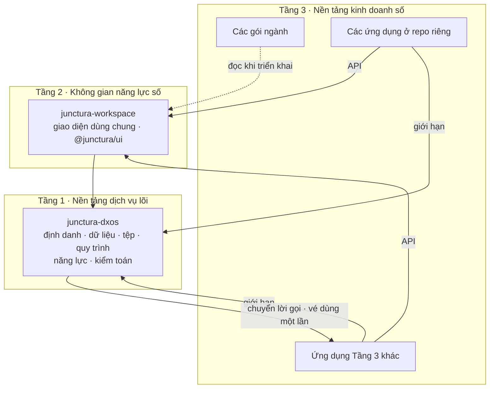

<!-- SPDX-FileCopyrightText: 2026 Junctura Contributors -->
<!-- SPDX-License-Identifier: Apache-2.0 -->

# Mô hình ba tầng

Tổ chức thường mua hoặc tự xây từng phần mềm rời rạc, mỗi phần mềm lại dựng riêng đăng nhập, dữ liệu, phân quyền và quy trình. Kết quả là những ốc đảo dữ liệu; hoặc ngược lại, một hệ nguyên khối buộc mọi thay đổi nghiệp vụ phải sửa vào lõi và khoá tổ chức vào một nhà cung cấp.

Junctura DX-OS chia hệ thống thành ba tầng để mỗi tầng giữ một mối quan tâm riêng: nền tảng dùng chung, không gian làm việc dùng chung và nghiệp vụ ngành. Tầng trên đổi nghiệp vụ mà không phải sửa tầng nền; tầng nền phục vụ nhiều ngành mà không mang từ vựng của ngành nào.

## Tầng 1 — Nền tảng dịch vụ lõi

**Vai trò.** Tầng 1 là nền tảng dịch vụ lõi (headless PaaS): cung cấp những dịch vụ mọi ứng dụng đều cần qua API, không phục vụ trực tiếp người dùng cuối. Tối thiểu gồm định danh và đăng nhập một lần, cổng API, dữ liệu có cấu trúc, lưu trữ tệp và động cơ quy trình; ngoài ra có quản lý bí mật, nhật ký được bảo vệ và xác minh bằng chuỗi băm SHA-256 (xác minh dựa trên dữ liệu và đầu chuỗi trong cơ sở dữ liệu), sao lưu/khôi phục và các dịch vụ chia sẻ năng lực giữa ứng dụng.

**Được làm**
- Cung cấp năng lực dùng chung qua API công khai, có định danh, phân quyền và ghi vết.
- Lưu mọi trạng thái của hệ thống: bản ghi, tệp, quy trình, định danh và bí mật.
- Chạy đầy đủ khi không có Console; Console chỉ là trang quản trị của lõi.

**Không được làm**
- Ghi cứng tên ngành, tên ứng dụng, tên đơn vị hay quy trình nghiệp vụ.
- Chạy nghiệp vụ ngành hoặc thay ứng dụng ra quyết định nghiệp vụ.
- Trở thành giao diện người dùng cuối của một ngành.

**Repo trong org:** `junctura-dxos` — lõi headless, Console quản trị và SDK `@junctura/server-client`.

## Tầng 2 — Không gian năng lực số

**Vai trò.** Tầng 2 số hoá các hoạt động quản trị dùng chung thành một không gian làm việc có giao diện người dùng cuối, trung lập ngành. Không gian này đi theo thang H–P–D–I: làm việc số, chuẩn hoá quy trình và hồ sơ, điều hành bằng dữ liệu, rồi hỗ trợ AI. Nghiệp vụ ngành không nằm trong mã Tầng 2 mà đến từ các gói ngành (pack) được đọc khi triển khai.

**Được làm**
- Cung cấp giao diện dùng chung: hồ sơ, công việc, bảng tin, danh bạ và các màn hình quản trị nội bộ.
- Dùng Tầng 1 qua SDK `@junctura/server-client`; cung cấp API cho ứng dụng Tầng 3.
- Đọc gói ngành để hiển thị quy trình, biểu mẫu và loại đơn vị do gói khai báo.

**Không được làm**
- Có cơ sở dữ liệu riêng, dùng SQLite hay ghi tệp lên đĩa.
- Ghi cứng tên ngành, tên ứng dụng hoặc quy tắc nghiệp vụ chuyên ngành.
- Tự quyết định nghiệp vụ thay cho ứng dụng Tầng 3.

**Repo trong org:** `junctura-workspace` — không gian làm việc chung, thư viện `@junctura/ui`. Repo đang được dựng.

## Tầng 3 — Nền tảng kinh doanh số

**Vai trò.** Tầng 3 mang nghiệp vụ chuyên ngành và cắm-rút được. Một gói ngành gồm hợp đồng năng lực, quy trình BPMN, loại đơn vị, lược đồ dữ liệu, danh mục dùng chung, dữ liệu mẫu và thư viện giao diện; các ứng dụng nghiệp vụ dùng gói đó để chạy quy trình của mình.

**Được làm**
- Dùng Tầng 2 qua API của không gian làm việc, và dùng Tầng 1 trong giới hạn cho phép.
- Trao đổi với ứng dụng Tầng 3 khác qua vé dùng một lần của Tầng 1, theo hợp đồng năng lực, đồng thuận và nhật ký. Khi bật thực thi năng lực, Core chuyển yêu cầu đến nhà cung cấp bằng vé dùng một lần và kiểm tra đồng thuận khi lời gọi có chủ thể dữ liệu, theo chính sách hiện hành.
- Rút ra khỏi hệ thống mà không làm hỏng Tầng 1 và Tầng 2.

**Không được làm**
- Gọi thẳng ứng dụng Tầng 3 khác.
- Dùng API quản trị của Tầng 1.
- Giữ cơ sở dữ liệu riêng hoặc ghi tệp cục bộ; dữ liệu nghiệp vụ phải nằm ở Tầng 1.

Các gói ngành và ứng dụng ở repo riêng.

## Nguyên tắc lưu trữ

Các ứng dụng đang chuyển dữ liệu về Tầng 1. Khi hoàn tất, ứng dụng Tầng 2 và Tầng 3 phải lưu trạng thái nghiệp vụ qua API Core: không SQLite, không ghi tệp lên đĩa, không đọc dữ liệu nghiệp vụ từ dữ liệu mẫu lúc chạy. Trạng thái — bản ghi, tệp, quy trình, định danh và bí mật — sẽ do Tầng 1 giữ; dữ liệu mẫu chỉ được nạp vào Tầng 1 qua API bằng lệnh dựng môi trường.

Khi đó:
- Có thể xoá container của một ứng dụng mà vẫn giữ dữ liệu.
- Khi mọi trạng thái ứng dụng đã chuyển về Tầng 1, sao lưu đồng bộ các kho của Tầng 1 sẽ bao phủ trạng thái đó. Phạm vi `npm run backup` và các thành phần cần sao lưu riêng được mô tả trong hướng dẫn vận hành.
- Console có thể thấy cấu trúc của dữ liệu đã chuyển về Core, không phải bản sao nghiệp vụ.

## Luật gọi giữa các tầng

| Bên gọi → bên được gọi | Luật | Cách |
| --- | --- | --- |
| Tầng 2 → Tầng 1 | Được | Backend Tầng 2 xác thực người dùng và gọi Core qua `@junctura/server-client` bằng định danh ứng dụng đã đăng ký. Ủy quyền thay mặt người dùng là hướng thiết kế, Core hiện chưa hỗ trợ. |
| Tầng 3 → Tầng 2 | Được | API của không gian làm việc: hồ sơ, công việc, bảng tin, danh bạ |
| Tầng 3 → Tầng 1 | Được, giới hạn | Đăng nhập, dữ liệu và tệp của chính ứng dụng, bản ghi danh mục đã được chủ sở hữu cấp quyền đọc cụ thể, vé gọi năng lực, đồng thuận; không dùng API quản trị. Quy trình liên đơn vị đi qua Tầng 2 |
| Tầng 3 → Tầng 3 | Cấm gọi thẳng | Chỉ qua vé dùng một lần của Tầng 1 theo hợp đồng năng lực |
| Tầng 1, Tầng 2 → tên ngành, tên ứng dụng | Cấm ghi cứng ở cả hai tầng | `npm run check:neutral` hiện chạy trong CI repo lõi, gồm mã Console |
| Ứng dụng → lưu trữ cục bộ | Cấm | `check:storage` ở các repo ứng dụng (dự kiến) |

Ứng dụng đọc bản ghi danh mục đã được chủ sở hữu cấp quyền đọc cụ thể. Chia sẻ theo nhóm và API ghi nhật ký nghiệp vụ đang ở mức hợp đồng dự kiến.

Cấm ghi cứng ở cả hai tầng. `npm run check:neutral` hiện chạy trong CI repo lõi, gồm mã Console, để chặn từ vựng ngành lọt vào Tầng 1 và Tầng 2. `check:storage` là kiểm tra dự kiến cho các repo ứng dụng, chưa có trong repo này.

## Phụ thuộc gói npm

Sơ đồ dưới đây mô tả hướng phụ thuộc dự kiến giữa các tầng. Tầng dưới không import gói của tầng trên.

```text
@junctura/server-client (Tầng 1)
  └── @junctura/ui (Tầng 2)
        └── Các gói ngành và ứng dụng ở repo riêng (Tầng 3)
```

Ứng dụng Tầng 3 dùng `@junctura/ui` và các gói của gói ngành; không tự dựng lại thành phần giao diện đã có ở Tầng 2.

## Sơ đồ



## Ba mức demo

1. **Chỉ Tầng 1:** chạy `junctura-dxos` với lõi và Console; chứng minh định danh, cổng API, dữ liệu, tệp, quy trình, chia sẻ năng lực và kiểm toán.
2. **Tầng 1 + Tầng 2:** thêm `junctura-workspace` và một gói ngành, sau đó đổi gói qua cấu hình. Tiêu chí đạt mức 2 là có ít nhất một ứng dụng H–P–D–I dùng Core trong một luồng đầu cuối.
3. **Đủ ba tầng:** thêm danh mục dùng chung và các ứng dụng ở repo riêng.

## Trạng thái hiện tại

- **Tầng 1:** đã chạy và được kiểm thử trong repo này.
- **Tầng 2:** đang dựng; giao diện dùng chung đang hoàn thiện.
- **Tầng 3:** các gói ngành và ứng dụng ở repo riêng đang chuyển dữ liệu về Tầng 1; mức demo thứ ba là dự kiến.

Các mục chưa xong được ghi rõ là "đang" hoặc "dự kiến"; không coi tài liệu thiết kế là tính năng đã chạy.
